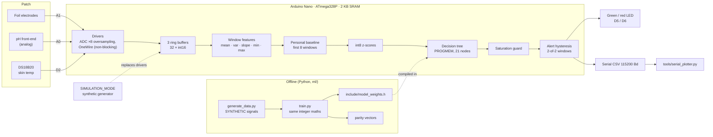

# Eco-Smart Wearable Biosensing Patch

[](https://github.com/aryavsparihar/ecosmart-wearable-biosensing-patch/actions/workflows/ci.yml)
[](LICENSE)
-00979D?logo=arduino&logoColor=white)


**A cloud-free biosensing patch built on an Arduino Nano with electrochemical electrodes and temperature sensors. A time-series classifier runs on the microcontroller itself, within its memory limits, to flag physiological anomalies in real time.**

> [!WARNING]
> **Research and educational prototype - not a medical device.**
> This project has **not** been clinically validated and must **not** be used to
> diagnose, treat, monitor or rule out any condition. The classifier is trained
> **only on synthetic data**. It flags deviations from the wearer's *own*
> short-term baseline; it does not detect or identify any disease. Conditions
> such as PCOS, hormonal imbalance, dysmenorrhea or irregular cycles appear in
> this repository only as *long-term research motivation*. If you have health
> concerns, talk to a qualified clinician.

---

## Overview

Sweat carries a continuous, non-invasive signal about the body: its acidity
(pH), its electrolyte concentration (conductivity) and the temperature of the
skin it comes from. This project explores whether a **low-cost, partly
biodegradable patch** can capture those signals and whether a **microcontroller
with 2 KB of RAM** can decide *on its own* when they drift away from what is
normal *for that wearer*, with no phone, no cloud and no data leaving the
device.

It has two halves:

| | What it is |
|---|---|
| **The patch** | A 7-layer stack: protective film, zigzag microfluidic channel, gelatin hydrogel pad, pH indicator zone, foil electrodes, cornstarch-bioplastic backing and an adhesive ring. Sweat wicks in through the channel, the hydrogel buffers excess, and the fluid reaches the pH zone and the electrodes. |
| **The electronics** | An Arduino Nano reading an analog pH channel (A0), the electrode conductivity divider (A1) and a DS18B20 skin-temperature probe (D2), driving a green "normal" LED and a red "possible irregularity" LED. |

On the Nano, the firmware:

1. samples all three channels at **1 Hz** using fixed-point integer maths,
2. slides a **32-sample window** forward every 8 samples and extracts
   **15 features** (mean, variance, regression slope, min and max per channel),
3. spends the first 8 windows (about 90 s) learning a **personal baseline**,
4. converts each later window into **int8 z-scores relative to that baseline**,
5. classifies them with a **depth-5 decision tree stored in flash** (21 nodes,
   144 bytes in total, int8 comparisons only), and
6. debounces the decision (2 consecutive windows) before switching the LEDs and
   logging a CSV event over serial.

**No hardware is needed to try any of it.** The firmware builds and its logic
is unit-tested on the host. It also runs in the browser on
[Wokwi](#simulate-in-wokwi-no-hardware), runs unmodified on an emulated
ATmega328P in CI, and has a `SIMULATION_MODE` that generates its own synthetic
signals.


<sub>The real `firmware.elf` in `SIMULATION_MODE`, executed on an emulated ATmega328P by the
CI <code>avr-smoke</code> job and plotted with <code>tools/serial_plotter.py</code>. It calibrates (grey), then raises and clears
the red-LED alert for each scripted episode: acidic pH, temperature rise, conductivity
surge, alkaline pH and electrode dropout. Signals are synthetic.</sub>

### Highlights

- **On-device TinyML in 2 KB of SRAM**: 773 B of static RAM in total
  (527 B for the whole signal pipeline), about 1.1 KB free at runtime, no heap,
  no `String`, all literals in flash.
- **Bit-exact Python ↔ C++ parity**: the training pipeline re-implements the
  firmware's integer arithmetic exactly, and a golden-vector test fails CI if a
  single feature, z-score, decision or alert differs.
- **Personal baselines**: anomalies are judged against the wearer's own first
  90 seconds, not against population thresholds.
- **Honest evaluation**: the train/test split is by subject, tree depth is
  chosen by grouped cross-validation, and the event-level metrics (detection
  rate, latency, false alerts per hour) come from the deployed, quantised model.
- **Five CI jobs**: AVR builds, 54 Unity tests, 31 pytest tests, a
  reproducible model export, an Arduino IDE (arduino-cli) compile, and an
  emulated firmware run on simavr. An optional Wokwi job runs when a token is
  configured.

---

## Patch design

### Layer stack

```text
          sweat in ──┐ inlet hole
                     ▼
 ┌──────────────────────────────────────────────┐  1  transparent protective sheet
 ├──╮ ╭──╮ ╭──╮ ╭──╮ ╭──────────────────────────┤  2  microfluidic zigzag channel
 │  ╰─╯  ╰─╯  ╰─╯  ╰─╯   (plastic + double-sided tape)
 ├──────────────────────────────────────────────┤  3  gelatin hydrogel pad (3 cm)
 ├────────────┬─────────────────────────────────┤  4  pH indicator zone (1×1 cm)
 ├────────────┴──── ▬▬▬▬▬▬   ▬▬▬▬▬▬ ─────────────┤  5  Cu / Al foil electrodes ──► A1
 ├──────────────────────────────────────────────┤  6  cornstarch bioplastic backing
 └───(((  adhesive ring  )))────────────────────┘  7  adhesive ring
                      skin
```


| # | Layer | Material | Role |
|---|---|---|---|
| 1 | Protective sheet | Transparent plastic film | Keeps dust out, lets you see the channel fill |
| 2 | Microfluidic channel | Transparent plastic + double-sided tape cut into a zigzag | Draws sweat in from the inlet and spreads it out in time |
| 3 | Absorbent pad | Gelatin hydrogel (10 g gelatin + 30 mL warm water), 3 cm discs | Holds excess fluid, keeps the sensing zones wet |
| 4 | pH zone | 1 × 1 cm universal-indicator strip | Visual pH read-out (colour change) |
| 5 | Electrodes | Copper or aluminium foil strips | Sweat conductivity / moisture, read on A1 |
| 6 | Backing | Cornstarch bioplastic (glycerin-plasticised) | Biodegradable structural base |
| 7 | Adhesive ring | Skin-safe adhesive tape | Seals the edge, holds the patch on the skin |

The full step-by-step build is in [docs/fabrication-guide.md](docs/fabrication-guide.md).

### System architecture



The same `pipeline.cpp` code runs on the Nano, in the host unit tests and in
`SIMULATION_MODE`, and `ml/ecosmart_ml/pipeline.py` is its bit-exact Python
mirror.

---

## Hardware

### Bill of materials

| Qty | Part | Notes |
|---|---|---|
| 1 | Arduino Nano (ATmega328P, 5 V, 16 MHz) | Clones with the CH340 USB chip work too |
| 1 | DS18B20 temperature sensor | TO-92 or waterproof probe; taped against the skin |
| 1 | 4.7 kΩ resistor | OneWire pull-up for the DS18B20 |
| 1 | 1 kΩ resistor | Lower leg of the electrode divider (`seriesResistorOhm`) |
| 1 | Green LED + 220 Ω resistor | "Within personal baseline" |
| 1 | Red LED + 220 Ω resistor | "Possible irregularity" |
| 1 | Analog pH front-end (optional) | e.g. a PH-4502C-style probe board on A0; otherwise read the indicator strip by eye |
| 2 | Copper or aluminium foil strips | Electrodes, about 3 × 20 mm, 2-3 mm apart |
| 1 | Breadboard + jumper wires | |
| 1 | USB power bank | Battery power, no mains connection to the wearer |
| - | Patch materials | Gelatin, cornstarch, vinegar, glycerin, transparent plastic, double-sided tape, universal-indicator paper, skin-safe adhesive tape |

### Pin map

| Nano pin | Signal | Direction | Defined in |
|---|---|---|---|
| `A0` | pH front-end output | analog in | `include/pins.h` → `pins::kPhSensor` |
| `A1` | Electrode divider midpoint | analog in | `pins::kConductivity` |
| `D2` | DS18B20 DQ (OneWire) | digital I/O | `pins::kTempOneWire` |
| `D5` | Green LED (via 220 Ω) | digital out | `pins::kLedGreen` |
| `D6` | Red LED (via 220 Ω) | digital out | `pins::kLedRed` |
| `5V`, `GND` | Supply for the sensors, the divider and the LED returns | | |

### Wiring

```text
                 Arduino Nano
              ┌───────────────┐
  pH board Po ┤A0           D2├──────┬───────────── DS18B20 DQ
              │               │    [4.7k]
 5V ─[foil A]~sweat~[foil B]─┬┤A1           5V├──────┴──┬── DS18B20 VDD
                             │   │               │         │
                          [1k]   │             D5├─[220]─►|─┐ green
                             │   │             D6├─[220]─►|─┤ red
                            GND ─┤GND            │          │
                                 └───────────────┘         GND (also DS18B20 GND)
```

- **Electrodes**: one foil strip goes to **5 V**, the other to **A1**, and A1
  goes to **GND through 1 kΩ**. A dry patch is an open circuit, so A1 reads
  about 0 and the firmware reports 0 mS/cm. Salty sweat bridging the strips
  pulls A1 up. With the default cell constant (10 cm⁻¹), the 0.5 % NaCl
  artificial sweat (about 9 mS/cm) sits near mid-scale (ADC ≈ 485).
- **DS18B20**: VDD to 5 V, GND to GND, DQ to D2, with a 4.7 kΩ resistor from
  DQ to 5 V.
- **LEDs**: anode → 220 Ω → D5 / D6, cathode → GND.
- **pH (optional)**: a probe board's analog output to A0. The default
  calibration assumes 2.50 V at pH 7 and −177 mV per pH unit. Use the two-point
  routine with the pH 4 and pH 9 buffers
  (`sensor_math::phCalibrationFromTwoPoints`) to fit your board.

> [!CAUTION]
> Power the patch only from a battery or USB power bank. Never connect it to
> anything mains-powered while someone is wearing it, and never wear it on
> broken or irritated skin.
