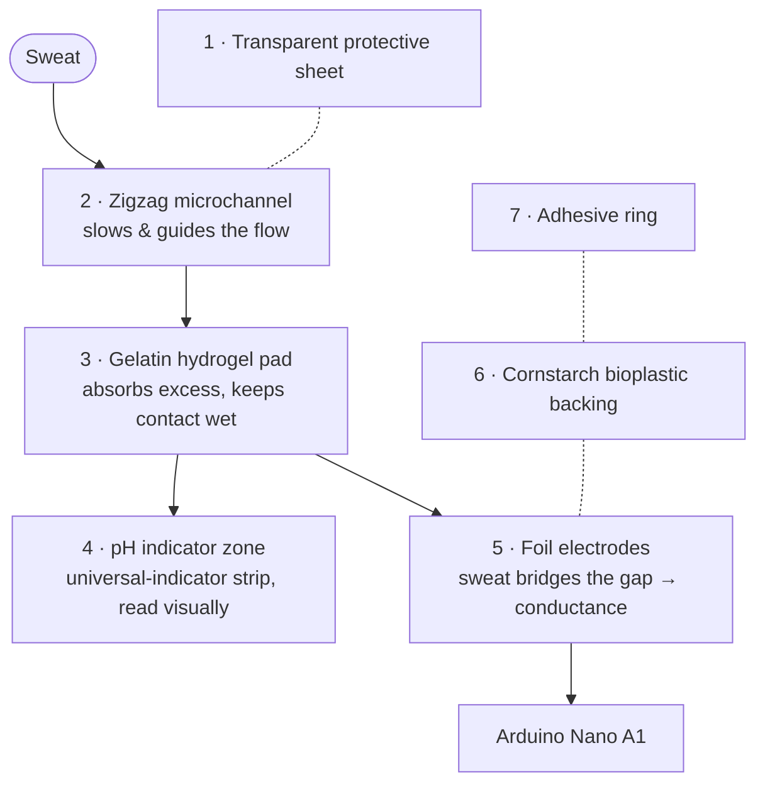
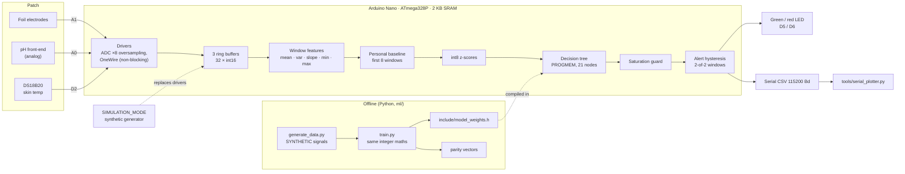
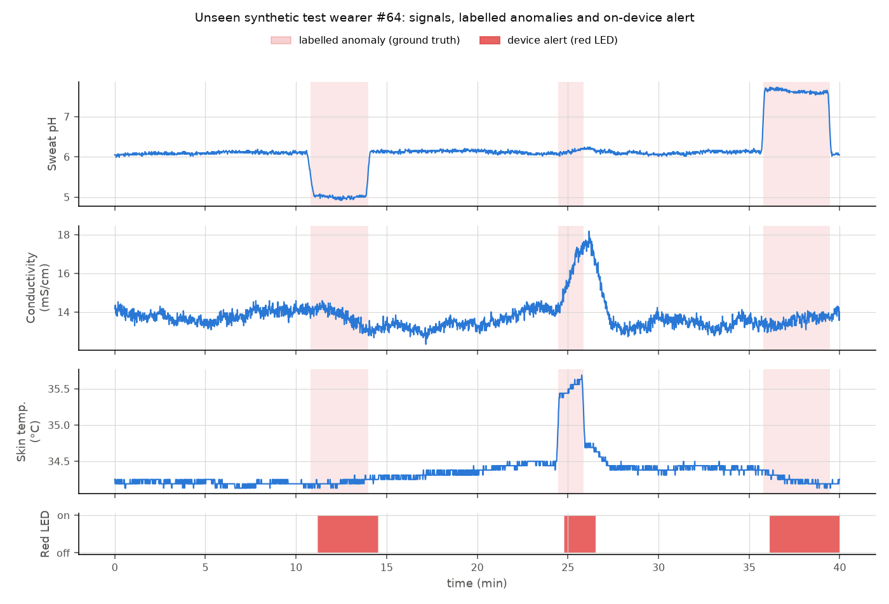
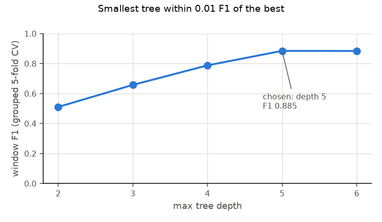

# Eco-Smart Wearable Biosensing Patch

[](https://github.com/aryavsparihar/ecosmart-wearable-biosensing-patch/actions/workflows/ci.yml)
[](LICENSE)
-00979D?logo=arduino&logoColor=white)


**A cloud-free biosensing patch built on an Arduino Nano with electrochemical electrodes and temperature sensors. A time-series classifier runs on the microcontroller itself, within its memory limits, to flag physiological anomalies in real time.**

> [!WARNING]
> **Research and educational prototype - not a medical device.**
> This project has **not** been clinically validated and must **not** be used to
> diagnose, treat, monitor or rule out any condition. The classifier is trained
> **only on synthetic data**. It flags deviations from the wearer's *own*
> short-term baseline; it does not detect or identify any disease. Conditions
> such as PCOS, hormonal imbalance, dysmenorrhea or irregular cycles appear in
> this repository only as *long-term research motivation*. If you have health
> concerns, talk to a qualified clinician.

---

## Overview

Sweat carries a continuous, non-invasive signal about the body: its acidity
(pH), its electrolyte concentration (conductivity) and the temperature of the
skin it comes from. This project explores whether a **low-cost, partly
biodegradable patch** can capture those signals and whether a **microcontroller
with 2 KB of RAM** can decide *on its own* when they drift away from what is
normal *for that wearer*, with no phone, no cloud and no data leaving the
device.

It has two halves:

| | What it is |
|---|---|
| **The patch** | A 7-layer stack: protective film, zigzag microfluidic channel, gelatin hydrogel pad, pH indicator zone, foil electrodes, cornstarch-bioplastic backing and an adhesive ring. Sweat wicks in through the channel, the hydrogel buffers excess, and the fluid reaches the pH zone and the electrodes. |
| **The electronics** | An Arduino Nano reading an analog pH channel (A0), the electrode conductivity divider (A1) and a DS18B20 skin-temperature probe (D2), driving a green "normal" LED and a red "possible irregularity" LED. |

On the Nano, the firmware:

1. samples all three channels at **1 Hz** using fixed-point integer maths,
2. slides a **32-sample window** forward every 8 samples and extracts
   **15 features** (mean, variance, regression slope, min and max per channel),
3. spends the first 8 windows (about 90 s) learning a **personal baseline**,
4. converts each later window into **int8 z-scores relative to that baseline**,
5. classifies them with a **depth-5 decision tree stored in flash** (21 nodes,
   144 bytes in total, int8 comparisons only), and
6. debounces the decision (2 consecutive windows) before switching the LEDs and
   logging a CSV event over serial.

**No hardware is needed to try any of it.** The firmware builds and its logic
is unit-tested on the host. It also runs in the browser on
[Wokwi](#simulate-in-wokwi-no-hardware), runs unmodified on an emulated
ATmega328P in CI, and has a `SIMULATION_MODE` that generates its own synthetic
signals.


<sub>The real `firmware.elf` in `SIMULATION_MODE`, executed on an emulated ATmega328P by the
CI <code>avr-smoke</code> job and plotted with <code>tools/serial_plotter.py</code>. It calibrates (grey), then raises and clears
the red-LED alert for each scripted episode: acidic pH, temperature rise, conductivity
surge, alkaline pH and electrode dropout. Signals are synthetic.</sub>

### Highlights

- **On-device TinyML in 2 KB of SRAM**: 773 B of static RAM in total
  (527 B for the whole signal pipeline), about 1.1 KB free at runtime, no heap,
  no `String`, all literals in flash.
- **Bit-exact Python ↔ C++ parity**: the training pipeline re-implements the
  firmware's integer arithmetic exactly, and a golden-vector test fails CI if a
  single feature, z-score, decision or alert differs.
- **Personal baselines**: anomalies are judged against the wearer's own first
  90 seconds, not against population thresholds.
- **Honest evaluation**: the train/test split is by subject, tree depth is
  chosen by grouped cross-validation, and the event-level metrics (detection
  rate, latency, false alerts per hour) come from the deployed, quantised model.
- **Five CI jobs**: AVR builds, 54 Unity tests, 31 pytest tests, a
  reproducible model export, an Arduino IDE (arduino-cli) compile, and an
  emulated firmware run on simavr. An optional Wokwi job runs when a token is
  configured.

---

## Patch design

### Layer stack

```text
          sweat in ──┐ inlet hole
                     ▼
 ┌──────────────────────────────────────────────┐  1  transparent protective sheet
 ├──╮ ╭──╮ ╭──╮ ╭──╮ ╭──────────────────────────┤  2  microfluidic zigzag channel
 │  ╰─╯  ╰─╯  ╰─╯  ╰─╯   (plastic + double-sided tape)
 ├──────────────────────────────────────────────┤  3  gelatin hydrogel pad (3 cm)
 ├────────────┬─────────────────────────────────┤  4  pH indicator zone (1×1 cm)
 ├────────────┴──── ▬▬▬▬▬▬   ▬▬▬▬▬▬ ─────────────┤  5  Cu / Al foil electrodes ──► A1
 ├──────────────────────────────────────────────┤  6  cornstarch bioplastic backing
 └───(((  adhesive ring  )))────────────────────┘  7  adhesive ring
                      skin
```



| # | Layer | Material | Role |
|---|---|---|---|
| 1 | Protective sheet | Transparent plastic film | Keeps dust out, lets you see the channel fill |
| 2 | Microfluidic channel | Transparent plastic + double-sided tape cut into a zigzag | Draws sweat in from the inlet and spreads it out in time |
| 3 | Absorbent pad | Gelatin hydrogel (10 g gelatin + 30 mL warm water), 3 cm discs | Holds excess fluid, keeps the sensing zones wet |
| 4 | pH zone | 1 × 1 cm universal-indicator strip | Visual pH read-out (colour change) |
| 5 | Electrodes | Copper or aluminium foil strips | Sweat conductivity / moisture, read on A1 |
| 6 | Backing | Cornstarch bioplastic (glycerin-plasticised) | Biodegradable structural base |
| 7 | Adhesive ring | Skin-safe adhesive tape | Seals the edge, holds the patch on the skin |

The full step-by-step build is in [docs/fabrication-guide.md](docs/fabrication-guide.md).

### System architecture



The same `pipeline.cpp` code runs on the Nano, in the host unit tests and in
`SIMULATION_MODE`, and `ml/ecosmart_ml/pipeline.py` is its bit-exact Python
mirror.

---

## Hardware

### Bill of materials

| Qty | Part | Notes |
|---|---|---|
| 1 | Arduino Nano (ATmega328P, 5 V, 16 MHz) | Clones with the CH340 USB chip work too |
| 1 | DS18B20 temperature sensor | TO-92 or waterproof probe; taped against the skin |
| 1 | 4.7 kΩ resistor | OneWire pull-up for the DS18B20 |
| 1 | 1 kΩ resistor | Lower leg of the electrode divider (`seriesResistorOhm`) |
| 1 | Green LED + 220 Ω resistor | "Within personal baseline" |
| 1 | Red LED + 220 Ω resistor | "Possible irregularity" |
| 1 | Analog pH front-end (optional) | e.g. a PH-4502C-style probe board on A0; otherwise read the indicator strip by eye |
| 2 | Copper or aluminium foil strips | Electrodes, about 3 × 20 mm, 2-3 mm apart |
| 1 | Breadboard + jumper wires | |
| 1 | USB power bank | Battery power, no mains connection to the wearer |
| - | Patch materials | Gelatin, cornstarch, vinegar, glycerin, transparent plastic, double-sided tape, universal-indicator paper, skin-safe adhesive tape |

### Pin map

| Nano pin | Signal | Direction | Defined in |
|---|---|---|---|
| `A0` | pH front-end output | analog in | `include/pins.h` → `pins::kPhSensor` |
| `A1` | Electrode divider midpoint | analog in | `pins::kConductivity` |
| `D2` | DS18B20 DQ (OneWire) | digital I/O | `pins::kTempOneWire` |
| `D5` | Green LED (via 220 Ω) | digital out | `pins::kLedGreen` |
| `D6` | Red LED (via 220 Ω) | digital out | `pins::kLedRed` |
| `5V`, `GND` | Supply for the sensors, the divider and the LED returns | | |

### Wiring

```text
                 Arduino Nano
              ┌───────────────┐
  pH board Po ┤A0           D2├──────┬───────────── DS18B20 DQ
              │               │    [4.7k]
 5V ─[foil A]~sweat~[foil B]─┬┤A1           5V├──────┴──┬── DS18B20 VDD
                             │   │               │         │
                          [1k]   │             D5├─[220]─►|─┐ green
                             │   │             D6├─[220]─►|─┤ red
                            GND ─┤GND            │          │
                                 └───────────────┘         GND (also DS18B20 GND)
```

- **Electrodes**: one foil strip goes to **5 V**, the other to **A1**, and A1
  goes to **GND through 1 kΩ**. A dry patch is an open circuit, so A1 reads
  about 0 and the firmware reports 0 mS/cm. Salty sweat bridging the strips
  pulls A1 up. With the default cell constant (10 cm⁻¹), the 0.5 % NaCl
  artificial sweat (about 9 mS/cm) sits near mid-scale (ADC ≈ 485).
- **DS18B20**: VDD to 5 V, GND to GND, DQ to D2, with a 4.7 kΩ resistor from
  DQ to 5 V.
- **LEDs**: anode → 220 Ω → D5 / D6, cathode → GND.
- **pH (optional)**: a probe board's analog output to A0. The default
  calibration assumes 2.50 V at pH 7 and −177 mV per pH unit. Use the two-point
  routine with the pH 4 and pH 9 buffers
  (`sensor_math::phCalibrationFromTwoPoints`) to fit your board.

> [!CAUTION]
> Power the patch only from a battery or USB power bank. Never connect it to
> anything mains-powered while someone is wearing it, and never wear it on
> broken or irritated skin.

---

## Fabrication recipes

These are the recipes used for the paper prototype. The full guide, with
cutting, assembly and safety notes, is in
[docs/fabrication-guide.md](docs/fabrication-guide.md).

### Cornstarch bioplastic backing (layer 6)

| Ingredient | Amount |
|---|---|
| Cornstarch | 20 g |
| Water | 60 mL |
| White vinegar | 5 mL |
| Glycerin | 5 mL |

1. Stir everything together cold until there are no lumps.
2. Heat gently to **70-80 °C**, stirring constantly. The mixture thickens and
   turns from milky white to **translucent**, gel-like.
3. Spread it 2-3 mm thick on baking paper or a smooth tray.
4. Let it **dry for 24 h** at room temperature, then peel it off and cut it to
   shape.

The glycerin acts as a plasticiser so the sheet stays flexible, and the vinegar
helps break up the starch granules for a more uniform film.

### Gelatin hydrogel pad (layer 3)

1. Dissolve **10 g gelatin in 30 mL warm water** (not boiling).
2. Pour it into a shallow mould about 3 mm deep and let it set.
3. Cut **3 cm discs**, and keep them covered so they don't dry out.

### Other layers

- **Microfluidic channel**: cut a zigzag channel (about 2 mm wide) through a
  strip of double-sided tape, stick it between two transparent plastic sheets,
  and punch an inlet hole at one end.
- **pH zone**: a 1 × 1 cm square of universal-indicator paper.
- **Electrodes**: two copper or aluminium foil strips about 2-3 mm apart, each
  with a jumper wire taped or crimped to its tail.

## Artificial sweat test procedure

**Test fluid**: artificial sweat = **100 mL distilled water + 0.5 g NaCl**
(0.5 % w/v). Its conductivity is roughly 9 mS/cm at room temperature, which is
in the range reported for human eccrine sweat.

**Demonstration buffers**: an **acidic pH 4-5** solution (for example diluted
white vinegar) and a **basic pH 8-9** solution (for example baking soda in
water). Confirm each one with indicator paper before use.

1. Flash the firmware (or the `SIMULATION_MODE` build to rehearse) and open
   the serial monitor or `tools/serial_plotter.py`.
2. With the patch **dry**, power it up and leave it untouched for the warm-up
   and calibration period (green LED blinking, about 90 s at 1 Hz). Then
   apply a few drops of artificial sweat at the inlet and wait for the reading
   to settle. *For a meaningful baseline, calibrate on the wetted patch*: send
   `r` over serial to restart calibration once the electrodes are wet.
3. Watch the fluid travel along the zigzag channel into the hydrogel. The
   indicator square should show the sweat's near-neutral colour, and the
   conductivity column on serial should rise from 0 to several mS/cm.
4. Add a drop of the **acidic** buffer, then later the **basic** buffer. The
   indicator colour changes visibly. On the electronics side, a step in
   conductivity or temperature (warm the DS18B20 between two fingers) away from
   the calibrated baseline turns the **red LED** on after two consecutive
   anomalous windows, and it turns off again when the signals return.
5. Record the log (`pio device monitor | tee session.csv`) and plot it with
   `python tools/serial_plotter.py --file session.csv`.

> [!NOTE]
> The indicator strip is read by eye. The firmware's pH channel (A0) needs an
> analog pH front-end, or the Wokwi potentiometer, to produce numbers. These
> bench tests show that the sensing chain works. They are not physiological
> measurements.

---

## Build, flash, simulate and test

### Prerequisites

```bash
git clone https://github.com/aryavsparihar/ecosmart-wearable-biosensing-patch.git
cd ecosmart-wearable-biosensing-patch
python3 -m venv .venv && source .venv/bin/activate
pip install platformio==6.2.0 -r ml/requirements.txt
```

> On Apple Silicon Macs, PlatformIO's AVR compiler is an x86-64 binary:
> install Rosetta once with `softwareupdate --install-rosetta`.

### PlatformIO environments

| Environment | What it builds | Command |
|---|---|---|
| `nanoatmega328` | Real firmware: sensors on A0, A1 and D2, 1 Hz | `pio run -e nanoatmega328` |
| `nanoatmega328_sim` | `SIMULATION_MODE`: an on-device synthetic generator replaces the sensors | `pio run -e nanoatmega328_sim` |
| `wokwi` | Real firmware, time-compressed 4× (250 ms per sample) for the Wokwi circuit | `pio run -e wokwi` |
| `simavr` | Simulation firmware, 50× faster, for the emulator smoke test | `pio run -e simavr` |
| `native` | Hardware-independent core for the host Unity tests | `pio test -e native` |

### Flash a real Nano

```bash
pio run -e nanoatmega328 -t upload        # or -e nanoatmega328_sim for the demo
pio device monitor -b 115200              # 'r' = recalibrate, 'm' = free RAM
python tools/serial_plotter.py --port /dev/ttyUSB0   # live plot (COMx on Windows)
```

The serial output is CSV. Lines starting with `#` are diagnostics:

```text
# Eco-Smart Wearable Biosensing Patch
# Research prototype - NOT a medical device, not for diagnosis.
# free_ram_bytes=1112
ms,ph,cond_mScm,temp_C,phase,p_anomaly,alert
33,5.54,8.40,34.13,WARMUP,0,0
...
# window=8 phase=MONITOR alert=0
# event: personal baseline calibrated, monitoring
# window=24 phase=MONITOR label=1 p=94 leaf=2 alert=1
# event: ALERT - possible irregularity vs baseline
```

**Arduino IDE users**: run `python tools/make_arduino_sketch.py` (add
`--simulation` for the demo build), then open
`build/arduino/ecosmart_patch/ecosmart_patch.ino`. Install **OneWire** from the
Library Manager, select **Arduino Nano**, and upload. CI compiles this exported
sketch with `arduino-cli` on every push.

### Simulate in Wokwi (no hardware)

[`diagram.json`](diagram.json) wires a virtual Nano to **two potentiometers**
standing in for the pH (A0) and electrode (A1) signals, a **DS18B20** with its
4.7 kΩ pull-up on D2, and the **green and red LEDs** with 220 Ω resistors on D5
and D6.

**VS Code**
1. Install the [Wokwi Simulator extension](https://marketplace.visualstudio.com/items?itemName=wokwi.wokwi-vscode) and run *Wokwi: Request a new License* (free).
2. `pio run -e wokwi`
3. Open `diagram.json` and press ▶ (or run *Wokwi: Start Simulator*). [`wokwi.toml`](wokwi.toml) points the simulator at `.pio/build/wokwi/firmware.hex`.
4. Wait about 22 s for calibration (green LED blinking → steady), then turn a
   potentiometer or click the DS18B20 to change its temperature. After two
   anomalous windows the red LED turns on.

**Browser**
1. Create a new *Arduino Nano* project at [wokwi.com](https://wokwi.com).
2. Replace its `diagram.json` with this repo's.
3. Run `python tools/make_arduino_sketch.py` and paste the generated files into
   the project (Wokwi's file menu lets you add `.h` and `.cpp` files). Add
   `OneWire` under *Library Manager*, and add `#define SAMPLE_PERIOD_MS 250UL`
   at the top of `config.h` to compress time.

**Self-running demo**: build `nanoatmega328_sim` and point both paths in
`wokwi.toml` at `.pio/build/nanoatmega328_sim/`. The firmware then cycles
through scripted anomaly episodes on its own, and the LEDs follow.

**CI**: the `wokwi` job runs this same circuit headlessly with
[wokwi-ci-action](https://github.com/wokwi/wokwi-ci-action). It runs only when
a `WOKWI_CLI_TOKEN` repository secret is set, and it fails if calibration
doesn't finish or the DS18B20 isn't found on the bus.

### Run the real firmware on an emulated ATmega328P

```bash
sudo apt-get install simavr                    # Linux
pio run -e simavr
timeout 30 simavr -m atmega328p -f 16000000 .pio/build/simavr/firmware.elf
```

The CI `avr-smoke` job does exactly this. It requires the serial output to
show calibration, an alert and its clearing, and it uploads the log as a build
artifact. The demo figure at the top of this README is that log.

### Tests

```bash
pio test -e native     # 54 Unity tests: ring buffer, fixed point, sensor maths,
                       # features, baseline, classifier, alert logic, pipeline,
                       # simulation end-to-end, Python<->C++ parity
pytest                 # 31 tests: Python mirror, generator, exporter, parity, plotter
```

| Test suite | What it proves |
|---|---|
| `test_parity` | The C++ pipeline reproduces the Python reference **bit for bit** (15 features, 15 z-scores, label, probability, leaf and alert for every window) on a synthetic recording plus random and out-of-range stress samples. A model fingerprint check catches stale vectors. |
| `test_simulation` | `SIMULATION_MODE` signals pass through the real model and pipeline: all 10 scripted episodes raise an alert, and no alert fires during normal periods. |
| `test_pipeline` | Window schedule, calibration hand-off, alert raise and clear, clamping, the saturation guard and reset. |
| `ml/tests/test_config.py` | The Python constants are parsed against `include/config.h`, so the two sides cannot drift apart. |

### Continuous integration

[`.github/workflows/ci.yml`](.github/workflows/ci.yml) runs on every push and
pull request:

| Job | Checks |
|---|---|
| Firmware build + native tests | All four AVR environments build (memory report in the job summary), and the Unity tests pass |
| ML pipeline + parity | pytest; regenerating the data and retraining reproduces `model_weights.h` byte for byte; the parity vectors are up to date |
| Arduino IDE sketch | The exported sketch compiles with `arduino-cli` in both sensor and simulation mode |
| Run firmware on simavr | The emulated Nano calibrates, raises and clears an alert |
| Wokwi simulation | (optional, needs a token) The circuit in `diagram.json` calibrates with a working DS18B20 |

---

## ML pipeline

```bash
python ml/generate_data.py          # SYNTHETIC dataset -> ml/data/synthetic_sweat.csv (gitignored)
python ml/train.py                  # -> include/model_weights.h, ml/model/model.json,
                                    #    docs/results/metrics.json, docs/img/*.png
python ml/export_parity_vectors.py  # -> test/test_parity/parity_vectors.h
pio test -e native                  # confirm the firmware agrees bit for bit
```

**1. Synthetic data** ([`ml/ecosmart_ml/synth.py`](ml/ecosmart_ml/synth.py)).
*All data in this project is synthetic. Nothing was recorded from people.*
The generator creates 120 "wearers" × 40 min at 1 Hz, with a fixed seed (2026).
Each wearer gets:
- a personal resting baseline: sweat pH 4.8-6.6, conductivity 4-14 mS/cm,
  skin temperature 33-35.5 °C;
- slow AR(1) drift, a slow skin-temperature oscillation and sensor noise;
- **benign exertion bumps** (more sweat, slightly warmer, +8-30 %
  conductivity), labelled *normal*: these are the hard negatives;
- 0-3 **anomaly episodes** of 1-4 min, each with smooth onset and recovery:
  acidic pH, alkaline pH, conductivity surge, electrode dropout, temperature
  rise, or a combined temperature + conductivity shift.

Every sample then passes through the **firmware's own sensor model**: 10-bit
ADC quantisation, the integer pH and conductivity conversions, and DS18B20
1/16 °C steps. Training data therefore sits on exactly the value grid the Nano
produces.

**2. Features and personal baseline.** These are computed by a Python port
([`pipeline.py`](ml/ecosmart_ml/pipeline.py)) of the C++ integer code, with
the same rounding (half away from zero), the same integer square root and the
same clamping. Each feature's scale floor is learnt from the training
population: it is the pooled robust spread (1.4826 × MAD) of normal windows
around each wearer's own calibration mean. Ninety seconds of calibration
cannot observe slow drift, and without these floors 59 % of normal windows
saturated `temp_mean` in an early version.

**3. Model choice: a shallow decision tree.**

| | Decision tree (chosen) | Logistic regression |
|---|---|---|
| Test-window F1 (synthetic) | **0.907** | 0.274 |
| Two-sided deviations (pH too low *or* too high) | Natural: two thresholds | A linear score can't express "far from zero in either direction" without hand-made \|z\| features |
| On-device inference | ≤ 5 int8 comparisons, no multiplications | 15 multiply-accumulates |
| Flash | 21 nodes × 4 B + 60 B of floors = **144 B** | about 76 B |
| Interpretability | Every path reads as a rule, e.g. `temp_mean > +3.9σ`, and is printed as a comment in the generated header | Weights |

The depth is selected by **grouped 5-fold cross-validation on the training
wearers** (no test data involved). The smallest depth within 0.01 F1 of the
best wins, which is depth 5. Splits whose two children always predict the same
label are collapsed (35 → 21 nodes) without changing any decision.

**4. Quantised export.** Features are int8 z-scores, so sklearn's
`z <= t.5` threshold is exactly `z <= floor(t)` in integers. The exported
tree is the model that gets evaluated, so there is no float/int mismatch.
[`include/model_weights.h`](include/model_weights.h) is generated, documented
and stored in `PROGMEM`.

**5. Saturation guard.** A window with ≥ 6 of its 15 z-scores pinned at ±127
(a shorted probe or garbage input) is unlike anything the tree has seen, and
the tree can route it to a "normal" leaf. Firmware and Python both flag such
windows outright. The guard fires on 0.08 % of normal windows.

## Results (synthetic data only)

> [!IMPORTANT]
> These numbers measure how well the pipeline separates the synthetic anomaly
> patterns it was designed around. They say **nothing** about real
> physiology, real sensors or any medical condition.

Held-out test set: **30 unseen synthetic wearers**, 20 monitored hours,
8,670 windows (8.6 % anomalous).

| Window-level metric | Train | **Test** |
|---|---|---|
| Accuracy | 0.988 | **0.984** |
| Precision | 0.903 | **0.904** |
| Recall | 0.946 | **0.910** |
| F1 | 0.924 | **0.907** |

| Test confusion matrix | Predicted normal | Predicted anomaly |
|---|---|---|
| **Actual normal** | 7,853 | 72 |
| **Actual anomaly** | 67 | 678 |

**Event level** (debounced alert, full on-device pipeline including the guard):

| Metric | Value |
|---|---|
| Anomaly episodes detected | **42 / 44 (95 %)** |
| Median detection latency | **23.5 s** from onset |
| False alerts | **0.3 per monitored hour** (6 in 20 h) |
| By type | acidic pH 6/6 · alkaline pH 9/9 · conductivity surge 8/8 · electrode dropout 7/7 · temperature + conductivity 7/7 · temperature rise 5/7 |

Window-level errors are concentrated at episode onsets and recoveries, where a
32-sample window straddles the labelled boundary. The two missed episodes are
small temperature rises; temperature is the slowest-moving channel and has the
coarsest sensor steps.

<p align="center">
  <br>
  
</p>

All figures and numbers are regenerated by `python ml/train.py`. The full
metrics are in [`docs/results/metrics.json`](docs/results/metrics.json).

## Memory budget

Measured from the PlatformIO build output (`avr-gcc` 7.3, `-Os`) on an
ATmega328P with 2,048 B SRAM and 30,720 B of usable flash (2 KB is the
bootloader):

| Build | Static RAM (.data + .bss) | Flash |
|---|---|---|
| `nanoatmega328` (sensors) | **773 B (37.7 %)** | **11,732 B (38.2 %)** |
| `nanoatmega328_sim` | 748 B (36.5 %) | 11,872 B (38.6 %) |

**Free SRAM at runtime**: **1,112 B**, reported by the firmware itself
(`# free_ram_bytes=`) while running on the emulated ATmega328P after
calibration (simulation build). This is the headroom left for the stack.

| Static RAM consumer | Bytes |
|---|---|
| `AnomalyPipeline` total | **527** |
| ├ 3 ring buffers (32 × int16 each + indices) | 198 |
| ├ Personal baseline (accumulators, then reused for mean/scale) | 242 |
| ├ Latest features (15 × int32) + z-scores (15 × int8) | 75 |
| └ Alert state, counters, last prediction | 12 |
| `HardwareSerial` (64 B RX + 64 B TX buffers) | 157 |
| Sensor drivers, LEDs, timers, Arduino core | ~90 |

Memory discipline:
- static allocation only: no `malloc`, no `new`, no `String`;
- every literal goes through `F()` or `PROGMEM`;
- the model and its floors live in flash;
- calibration accumulators are overlaid by the frozen baseline statistics,
  which saves 120 B;
- the DS18B20 driver talks OneWire directly instead of pulling in
  DallasTemperature;
- `m` over serial prints the current free RAM.
