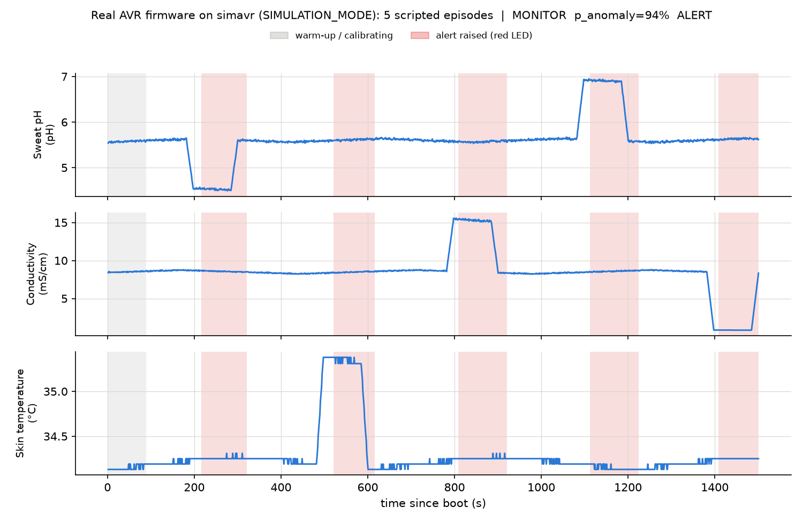

# Eco-Smart Wearable Biosensing Patch

-00979D?logo=arduino&logoColor=white)

**A cloud-free biosensing patch built on an Arduino Nano with electrochemical electrodes and temperature sensors. A time-series classifier runs on the microcontroller itself, within its memory limits, to flag physiological anomalies in real time.**

> [!WARNING]
> **Research and educational prototype - not a medical device.**
> This project has **not** been clinically validated and must **not** be used to
> diagnose, treat, monitor or rule out any condition. The classifier is trained
> **only on synthetic data**. It flags deviations from the wearer's *own*
> short-term baseline; it does not detect or identify any disease. Conditions
> such as PCOS, hormonal imbalance, dysmenorrhea or irregular cycles appear in
> this repository only as *long-term research motivation*. If you have health
> concerns, talk to a qualified clinician.

---

## Overview

Sweat carries a continuous, non-invasive signal about the body: its acidity
(pH), its electrolyte concentration (conductivity) and the temperature of the
skin it comes from. This project explores whether a **low-cost, partly
biodegradable patch** can capture those signals and whether a **microcontroller
with 2 KB of RAM** can decide *on its own* when they drift away from what is
normal *for that wearer*, with no phone, no cloud and no data leaving the
device.

It has two halves:

| | What it is |
|---|---|
| **The patch** | A 7-layer stack: protective film, zigzag microfluidic channel, gelatin hydrogel pad, pH indicator zone, foil electrodes, cornstarch-bioplastic backing and an adhesive ring. Sweat wicks in through the channel, the hydrogel buffers excess, and the fluid reaches the pH zone and the electrodes. |
| **The electronics** | An Arduino Nano reading an analog pH channel (A0), the electrode conductivity divider (A1) and a DS18B20 skin-temperature probe (D2), driving a green "normal" LED and a red "possible irregularity" LED. |

On the Nano, the firmware:

1. samples all three channels at **1 Hz** using fixed-point integer maths,
2. slides a **32-sample window** forward every 8 samples and extracts
   **15 features** (mean, variance, regression slope, min and max per channel),
3. spends the first 8 windows (about 90 s) learning a **personal baseline**,
4. converts each later window into **int8 z-scores relative to that baseline**,
5. classifies them with a **depth-5 decision tree stored in flash** (21 nodes,
   144 bytes in total, int8 comparisons only), and
6. debounces the decision (2 consecutive windows) before switching the LEDs and
   logging a CSV event over serial.

**No hardware is needed to try any of it.** The firmware builds and its logic
is unit-tested on the host. It also runs in the browser on
[Wokwi](#simulate-in-wokwi-no-hardware), runs unmodified on an emulated
ATmega328P in CI, and has a `SIMULATION_MODE` that generates its own synthetic
signals.

The real `firmware.elf` in `SIMULATION_MODE`, executed on an emulated ATmega328P by the
CI <code>avr-smoke</code> job and plotted with <code>tools/serial_plotter.py</code>. It calibrates (grey), then raises and clears
the red-LED alert for each scripted episode: acidic pH, temperature rise, conductivity
surge, alkaline pH and electrode dropout. Signals are synthetic.

### Highlights

- **On-device TinyML in 2 KB of SRAM**: 773 B of static RAM in total
  (527 B for the whole signal pipeline), about 1.1 KB free at runtime, no heap,
  no `String`, all literals in flash.
- **Bit-exact Python ↔ C++ parity**: the training pipeline re-implements the
  firmware's integer arithmetic exactly, and a golden-vector test fails CI if a
  single feature, z-score, decision or alert differs.
- **Personal baselines**: anomalies are judged against the wearer's own first
  90 seconds, not against population thresholds.
- **Honest evaluation**: the train/test split is by subject, tree depth is
  chosen by grouped cross-validation, and the event-level metrics (detection
  rate, latency, false alerts per hour) come from the deployed, quantised model.
- **Five CI jobs**: AVR builds, 54 Unity tests, 31 pytest tests, a
  reproducible model export, an Arduino IDE (arduino-cli) compile, and an
  emulated firmware run on simavr. An optional Wokwi job runs when a token is
  configured.
